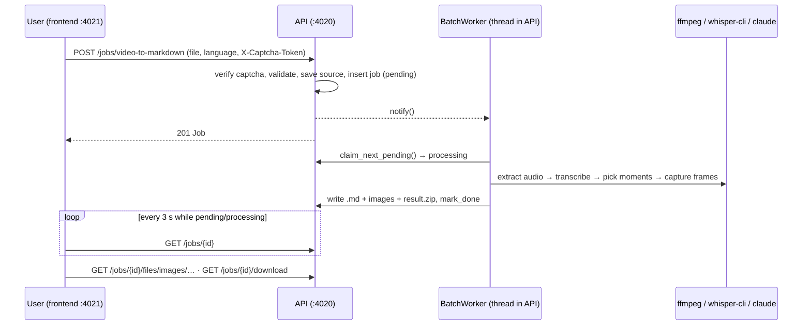
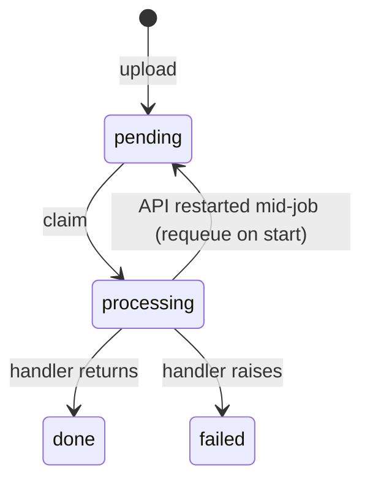

# Design note — video to Markdown

| Field | Value |
| --- | --- |
| Date | 2026-09-27 |
| Updated | 2026-09-27 |
| Status | Implemented (scaffold + first feature), not yet run end-to-end against a real video |
| Scope | `api/` (jobs module, batch worker, `video_to_markdown` pipeline), `frontend/` (upload, job list, job detail) |
| Ticket | none (personal project) |

## User Story

As a person with a screen recording, meeting or tutorial video, I want to turn it into a Markdown note
that has the spoken words and a screenshot at every important moment, so I can read, search and share
the content without replaying the video. The important moments are chosen from what is said.

## Why This Approach

| Decision | Summary | Home of the rationale |
| --- | --- | --- |
| Batch worker inside the API process, long-polling MySQL | Worker runs only while the instance is up; no broker | [api A1](../../api/docs/decisions.md) |
| Interrupted jobs are requeued, not failed | Restart / `--reload` must not fail good jobs | [api A2](../../api/docs/decisions.md) |
| Key moments from `claude -p --json-schema` | Uses the user's Claude login; schema-checked reply | [api A3](../../api/docs/decisions.md) |
| Local whisper.cpp | Free, offline, vi / ja / en | [api A4](../../api/docs/decisions.md) |
| Relative image paths in the `.md` | Same file works in the zip and in the preview | [frontend F3](../../frontend/docs/decisions.md) |
| XHR upload with progress | Videos can be gigabytes | [frontend F1](../../frontend/docs/decisions.md) |

## Diagrams

## User Stories + Acceptance Criteria

### US1 — Upload a video

| # | Given | When | Then |
| --- | --- | --- | --- |
| 1 | a `.mp4/.mov/.mkv/.webm/.avi/.m4v` file and a solved captcha | submit | 201, job `pending`, the browser moves to `/jobs/{id}` |
| 2 | a `.txt` file | submit | 400 `Unsupported file type '.txt'…` shown in the form |
| 3 | a file over `MAX_UPLOAD_MB` | submit | 413, nothing left on disk |
| 4 | a rejected captcha token | submit | 403, no job created |

### US2 — Follow the job

| # | Given | When | Then |
| --- | --- | --- | --- |
| 1 | a running job | the detail page is open | the current step is highlighted, refreshed every 3 s |
| 2 | a job that failed | the detail page is open | the error message and the failed step are shown; polling stops |
| 3 | the API restarts mid-job | it comes back | the job is `pending` again and re-runs from the start |

### US3 — Get the Markdown

| # | Given | When | Then |
| --- | --- | --- | --- |
| 1 | a `done` job | the detail page is open | the Markdown preview shows every heading, screenshot and transcript paragraph |
| 2 | a `done` job | click Download | `<video-name>.zip` with `<video-name>.md` and `images/` |
| 3 | a video with no speech | the job runs | `failed` with `No speech was detected in the video` |

Involved systems: frontend, api, MySQL, ffmpeg, whisper-cli, claude CLI, captcha provider.

## Detailed Design

### Chunk 1 — Jobs module + HTTP contract (api)

Routes, JSON shape and status codes: [dependency-graph.md](../dependency-graph.md).
Layers: `router.py` → `JobService` → `JobRepository` / `JobStorage`; errors mapped in `http_errors.py`.

> Design decisions: the upload request only saves the file and inserts the row. All processing happens
> in the worker, so a multi-GB video never holds an HTTP request open past a proxy timeout.

> Design decisions: `jobs.type` + `jobs.options` (JSON) make the table generic. The next video
> operation adds a `JobType` value and a handler — no new table and no new worker.

### Chunk 2 — Batch worker (api)

`BatchWorker` thread: `claim_next_pending` → `handler.handle(job, report_step)` → `mark_done` /
`mark_failed`. When idle it waits `BATCH_POLL_INTERVAL_SEC` or until `notify()`.

> Design decisions: the claim is a conditional `UPDATE … WHERE status='pending'` checked by
> `rowcount`, so a lost race returns "nothing claimed" instead of running a job twice.

> Design decisions: shutdown order is `stop()` → `CommandRunner.terminate_all()` →
> `wait_until_stopped()`. The killed command raises after the stop flag is set, so the worker leaves
> the job `processing` (requeued on the next start) instead of marking it `failed`.

### Chunk 3 — `video_to_markdown` pipeline (api)

| Step | Code | Notes |
| --- | --- | --- |
| extract audio | `FfmpegMediaProcessor.extract_audio` | 16 kHz mono PCM WAV — whisper.cpp's required input |
| transcribe | `WhisperCppTranscriber.transcribe` → `whisper_json_to_transcript` | drops `[BLANK_AUDIO]` / `(music)` markers; detected language kept when `auto` |
| pick moments | `ClaudeMomentPicker.pick_outline` → `normalize_moments` | prompt lines `[start_ms] text`; reply `{title, summary, moments[{atMs, title}]}` |
| capture frames | `FfmpegMediaProcessor.capture_frame` | `-ss` before `-i` (fast seek), max width 1280 px, JPEG |
| write Markdown | `build_markdown` + `JobStorage.write_archive` | each segment goes under the last moment starting at or before it |

> Design decisions: moment times are milliseconds taken from transcript line starts, not free
> timestamps. Claude only chooses among lines it saw, so a heading never lands mid-sentence.

> Design decisions: `normalize_moments` clamps to `[0, duration − 500 ms]` (a seek at the very end
> yields no frame), drops blank titles, merges moments closer than 3 s, and caps at `MAX_MOMENTS`. The
> model's output is treated as untrusted input.

> Design decisions: text before the first moment is rendered as a plain paragraph under the summary,
> with no heading and no screenshot. The prompt asks for a first moment at the first line, so this is
> normally empty.

> Design decisions: an empty transcript fails the job rather than producing a screenshot-only note.
> Without speech there is nothing to pick moments from.

### Chunk 4 — Frontend

`UploadVideoForm` (file + language + captcha, XHR progress) → `/jobs/[id]` `JobDetailPanel`
(`JobStepProgress`, `MarkdownPreview`, download link). `JobList` on `/`. Server data only through
`features/jobs/queries.ts`; the language preference is the only Redux state.

> Design decisions: the captcha widget is reset after every submit attempt, because tokens are
> single-use and a retry with a spent token always answers 403.

## File summary

| Area | Files | New / Modified | Purpose |
| --- | --- | --- | --- |
| api core | `app/main.py`, `config.py`, `container.py`, `db.py`, `logger.py` | New | app factory, settings, composition root, UTC datetime type, daily log |
| api common | `app/common/process.py`, `captcha.py` | New | external-program boundary, captcha adapter |
| api batch | `app/batch/worker.py` | New | long-polling worker + `JobHandler` protocol |
| api jobs | `app/modules/jobs/{models,repository,service,storage,schemas,router,errors,http_errors}.py` | New | jobs module |
| api pipeline | `app/modules/jobs/video_to_markdown/{handler,ffmpeg_media,whisper_transcriber,claude_moment_picker,transcript,moments,markdown}.py` | New | the job type |
| api db | `alembic/env.py`, `alembic/versions/0001_create_jobs.py` | New | `jobs` table |
| api tests | `tests/*.py` (117 tests, 97 % branch coverage; `repository.py` untested) | New | unit tests, mocks only |
| frontend | `src/**` (atoms / molecules / organisms / templates, `features/jobs`, `lib/api`, `lib/captcha`, `store`) | New | UI |
| workspace | `run.sh`, `.gitignore`, `.node-version`, `.claude/`, docs | New | tooling + AI docs |

## Risks & Mitigations

| Risk | Impact | Mitigation | Where |
| --- | --- | --- | --- |
| Two API instances on one DB | the second requeues the first's live job → duplicate work | run one instance per DB; heartbeat needed before scaling | api ADR A2 |
| Claim / requeue SQL has no automated test | a regression in `repository.py` goes unnoticed | manual check on `start_test`; add E2E | testing-strategy |
| Global `~/.claude/CLAUDE.md` still loads for `claude -p` | titles in the wrong language | prompt demands the transcript's language; cwd outside the repo | api ADR A3 |
| Long videos | whisper / ffmpeg exceed their timeout | `WHISPER_TIMEOUT_SEC`, `MEDIA_TIMEOUT_SEC` in `.env` | workflow-debugging |
| `--reload` during a job | the job restarts from the beginning | expected; child processes are terminated first | workflow-running-the-workspace |
| whisper.cpp emits invalid UTF-8 | JSON parse fails | read with `errors="replace"` | `whisper_transcriber.py` |
